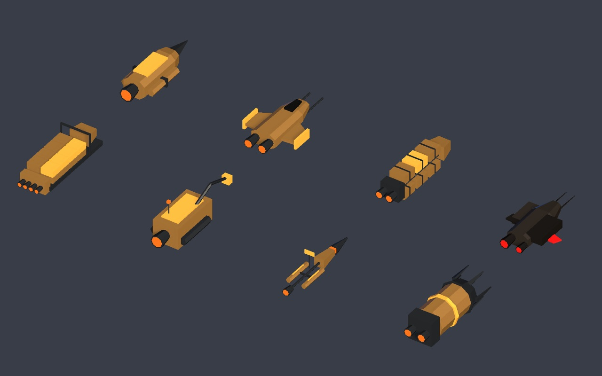
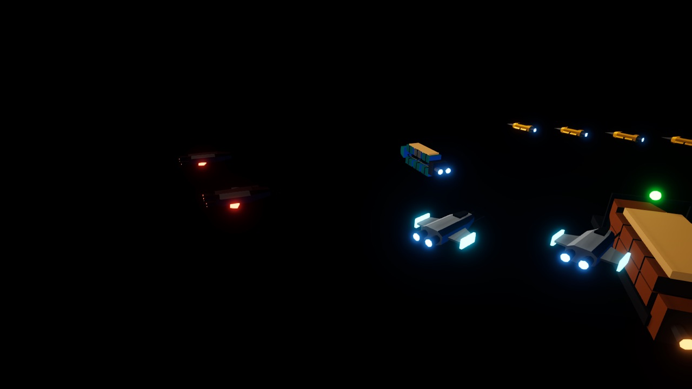

# #14 Foundry ship models, imported at edit time

GitHub issue: [#14](https://github.com/deadronos/Vibe-Space-Mining-Fleet/issues/14). Decision: [ADR 0017](../../agents/decisions/0017-foundry-models-at-edit-time.md).

## Where the code lives

| | |
| --- | --- |
| UVCS branch | `/main/feature-14-foundry-models` (started as `feature-14-foundry-spike`, renamed) |
| Changeset | `cs:71`, merged into `/main` as `cs:74` |
| Repository | `Vibe-Space-Mining-Fleet/Vibe-Space-Mining-Fleet@iridanblub@unity` |

## What changed in the Unity project

- `Assets/_Game/Models/`: the eight Foundry `.glb` ships from asteroid-fleet (barge, drone, fighter, harvester, hauler, pirate, repair, scout; MIT, same author) and a README. The carrier keeps its own hull because of its working landing bay, so `foundry_carrier.glb` is not imported.
- `Scripts/Editor/GlbMeshImporter.cs`: a `ScriptedImporter` for `.glb` that covers what the Foundry exports use (one mesh, POSITION and NORMAL, one primitive per material, no textures). It mirrors X and reverses the winding to go from glTF to Unity axes; the nose stays on +Z. No package, nothing at runtime.
- `Scripts/Editor/FoundryHulls.cs`: places a model on a unit prefab, scaled to a target length, with each glTF slot mapped to a project material. It finds the engine nozzles (the `glow` parts behind mid-ship) so the engine trails sit on them.
- `Scripts/Editor/MiningFleetSceneBuilder.cs`: drone, barge, hauler, fighter and raider use their Foundry hull and fall back to the old primitive build when the `.glb` is missing. New `Trail` and `SetRefs` helpers replace five copies of the trail setup.
- `Scripts/Views/DroneBatchRenderer.cs`: merges per submesh, not per renderer, because an imported hull is one renderer with several materials.
- `Tests/EditMode/FoundryModelTests.cs`: 34 asset checks (below).
- Prefabs, `MiningFleet.unity` and `MiningFleetVolume.asset` regenerated by **Build Demo Scene**.

| Class | Model | Length | Slots → materials |
| --- | --- | --- | --- |
| Drone | `foundry_drone` | 2.6 | hull DroneHull, hull2 + metalRed DroneDark, glow DroneEngine |
| Barge | `foundry_barge` | 12 | hull BargeHull, hull2 CarrierDark, metalRed CarrierAccent, glow BayStrip |
| Hauler | `foundry_hauler` | 6.0 | hull HaulerHull, hull2 CarrierDark, metalRed CarrierHull, glow EngineGlow |
| Fighter | `foundry_fighter` | 2.2 | hull FighterHull, hull2 + dark CarrierDark, metalRed DroneCockpit, glow EngineGlow |
| Raider | `foundry_pirate` | 3.4 | hull PirateHull, hull2 CarrierDark, metalRed + glow PirateGlow |

Lengths are a little above the old primitive hulls (drone 1.9, hauler 5.2, fighter 1.8, raider 2.5): the models are slimmer, and at the old lengths drones and raiders were hard to read at game distance.

## Build size

Gzipped files in `web/public/unity/Build`, as served:

| Build | data | wasm |
| --- | --- | --- |
| Baseline, rebuilt from `/main` cs:70 (same bytes as v0.14.0) | 3,143,393 B | 7,503,287 B |
| Spike, barge only | 3,147,982 B (+4,589) | 7,500,721 B |
| This change, five classes | 3,158,791 B (**+15,398, +0.5%**) | 7,501,570 B (unchanged within noise) |

The Build Report lists the five meshes at 95 KB uncompressed together (hauler 32 KB, barge 26 KB, fighter 14 KB, pirate 13 KB, drone 11 KB). The repair, scout and harvester models are not referenced, so they are not in the build.

## Verification

- `scripts/unity-check.sh`: compiled, EditMode **211 of 211** passed (177 before plus 34 new).
  - every model imports as a readable mesh with one submesh per slot;
  - at least 95% of faces agree with their normals (catches a missing winding flip after the X mirror);
  - the engine glow is behind mid-ship (nose on +Z);
  - unit prefabs use only materials from `Assets/_Game/Materials` (the importer's placeholders never reach the build);
  - each unit prefab has its Foundry hull (five on the squadron) and engine trails.
- Web build in the browser on a clean origin (port 5199), WebGPU and `?renderer=webgl2`: drones, barges, hauler, squadron and raiders render, no console errors, and the player logs `batched drones` (the per-submesh merge works).
- Close-ups were rendered in the Editor with the scene's camera, lights and URP volume (see the learnings log for why).

## Open points

- The barge's ore fill reads as a flat lid on top of the cargo pods, not a heap.
- Engine glow now comes from each model's nozzles; the old glow spheres are gone. The barge still has no engine trails (it never had any).
- If a runtime glTF package is ever added (#29), its `.glb` importer would clash with `GlbMeshImporter`. Pick one.
- Repair and scout ships as new units (repair beam, automated surveys, vein bonus) are the next piece of work, using the models imported here.
