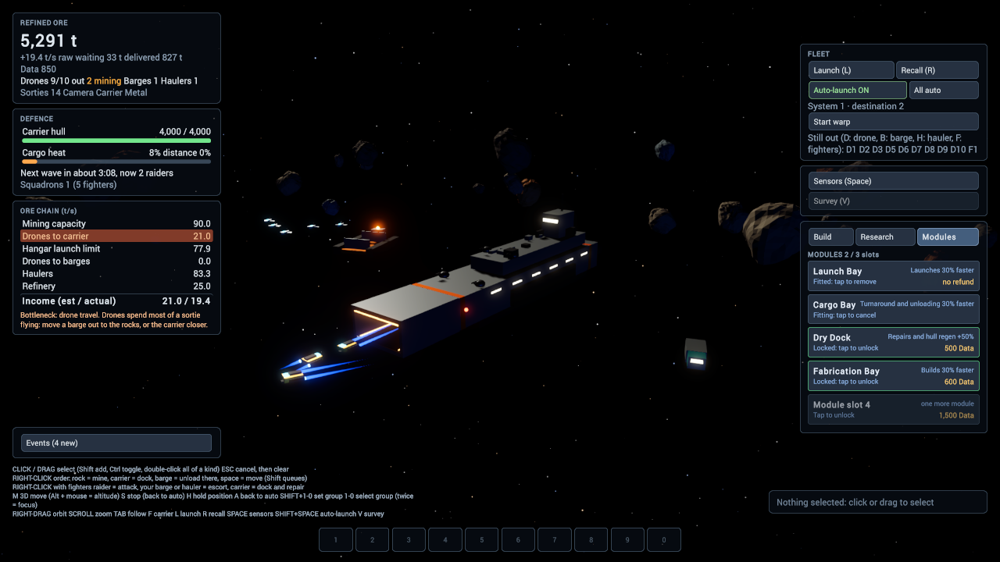

# Carrier modules and HUD pass

[GitHub issue #59](https://github.com/deadronos/Vibe-Space-Mining-Fleet/issues/59). Follows [ADR 0013](../../agents/decisions/0013-hangar-types-as-carrier-modules.md) (hangar types become carrier modules) and [ADR 0005](../../agents/decisions/0005-ui-toolkit-hud.md) (UI Toolkit HUD).

**Status:** the UI plan and the module proposal are agreed (10 Nov 2026). Carrier modules are built, tested in the Editor and checked in as cs:48 on their branch (not merged to `/main`). The HUD pass and the web build are still to do.

- **Plan:** [plan.md](plan.md).

## Branches

| Piece | Git | UVCS |
|---|---|---|
| UI plan (this note and the mock) | `feature/59-ui-plan` | none |
| Carrier modules | `feature/59-carrier-modules` | `/main/feature-59-carrier-modules`, from cs:47. Changeset cs:48, not merged |
| HUD pass | `feature/59-hud-pass` | `/main/feature-59-hud-pass` |

The HUD pass branches from the modules branch once that is merged, because the carrier panel shows module slots.

## Decided by the user (10 Nov 2026)

- **Slots:** the carrier has a few slots. Any module fits any slot, and modules can be swapped.
- **Unlock and cost:** research (Data) unlocks a module type once. Fitting it costs refined ore and goes through the build queue.
- **HUD:** a new layout, not a restyle in place.
- **Plan format:** a clickable HTML mock, [mock.html](mock.html).

## UI plan

Open [mock.html](mock.html) in a browser. The purple bar at the bottom belongs to the mock: it fakes a selection so the command bar changes. `B`, `T`, `G` and `Space` work in the mock.

1. **Resource strip (top).** Refined ore and income, Data, drones out, barge, hauler and squadron counts, the raid countdown and the system name. It has no buttons.
2. **Carrier panel (top left).** Hull, cargo heat and the module slots. It replaces the Defence panel. Clicking a slot opens the Modules tab. The ore chain sits below it and still collapses to its bottleneck line.
3. **Manager (top right).** One panel with three tabs: Build, Research, Modules. It is closed by default so the view stays clear. The build queue lives in the Build tab; module fittings show in the same queue.
4. **Bottom row.** The selection list (left), a command bar that follows the selection (centre), the event log (right), and the control-group bar above the command bar.
   - Nothing selected: Launch, Recall, Auto-launch, All auto, Survey, Start warp.
   - Miners: Move, Stop, Hold, Back to auto, Recall.
   - Squadrons: Move, Stop, Hold, Survey, stances, formations.
   - Carrier: Move, Stop, Start warp, Build, Modules, Launch, Recall.
5. **Sensors view.** The manager and ore chain hide; a legend appears. The strip, carrier panel and bottom row stay.

The long controls text in the bottom left goes away. The command bar shows each command's key, and the right-click hints appear in the bar for the selected unit type.

### Controls

Every existing key keeps its meaning (ADR 0006, 0007, 0009): `L`, `R`, `Shift+Space`, `Space`, `V`, `M`, `A`, `S`, `H`, `Tab`, `F`, `Esc`, `1` to `0`.

Three keys are new, all unused today: `B` Build, `T` Research, `G` Modules. `Esc` closes the manager before it clears the selection.

### Look

The mock uses only what USS can draw: flat colours, 1 px borders, a brighter top edge on the main panels, 3 to 4 px corners. It keeps the current palette (dark navy panels, green for "on", amber for warnings, red for raiders) and Roboto. Homeworld gives the structure (strip, manager, context command bar, sensors); none of its art or layouts is copied.

## Carrier modules: proposal

Proposed by the agent; agreed by the user on 10 Nov 2026.

| Module | Effect | Fit cost (ore) | Fit time | Unlock (Data) |
|---|---|---:|---:|---:|
| Launch Bay | Hangar launch interval −30% | 2,000 | 30 s | free at start |
| Cargo Bay | Drone turnaround and unloading at the carrier 30% faster | 2,500 | 30 s | 400 |
| Dry Dock | Docked squadron repair and carrier hull regen +50% | 3,000 | 40 s | 500 |
| Fabrication Bay | Build queue 30% faster | 3,500 | 40 s | 600 |

- **Slots:** 2 at the start. A third (800 Data) and a fourth (1,500 Data) are one-off research unlocks. With four modules and four slots a late game fits everything; the choice matters early and in the middle.
- **No duplicates.** Each module type fits once.
- **Removing** a module is instant and gives no refund. Its effect stops at once.
- **Fitting** is a build-queue item. It can be cancelled like any other, with the same refund rule as units.
- **Save:** version 7 adds the slot count, the fitted modules and the unlocked module types. Older saves load with 2 empty slots and only the Launch Bay unlocked.
- **Shared model with ship modules (#23):** one `ModuleDef` (id, host kind, effect, cost, time), with the carrier as the first host. #23 adds ship hosts later; it is not built here.

## Carrier modules: what changed

All in the Unity project, in cs:48 on `/main/feature-59-carrier-modules` (8 files added, 9 changed).

- **Model** (`Sim/Modules.cs`): `CarrierModule`, `ModuleDef`, `ModuleSettings` with the table above as its default, and `ModuleMath` for names and effect texts.
- **State and rules** (`Sim/FleetSim.Modules.cs`): slots, unlocked types and fitted modules; the commands `UnlockModule`, `UnlockSlot`, `FitModule` and `RemoveModule`; the events `ModuleUnlocked`, `ModuleFitted` and `ModuleRemoved`.
- **Build queue:** a `BuildItem` can be a module fitting. It pays its ore when it starts, is refunded on cancel once started, and holds a slot while it is queued. A carrier retreat clears queued fittings and keeps fitted modules.
- **Effects:** applied where research rebuilds the settings, so research and modules stack. The Cargo Bay shortens drone turnaround in the hangar and speeds up hauler unloading at the carrier.
- **Save:** version 7, as proposed. A save that names an unknown, duplicate or locked module, or more modules than slots, is refused and changes nothing.
- **HUD:** a plain Modules tab in the Build panel, one button per module and one for the next slot. Queue rows and the event log name modules.

### How it was verified

- `scripts/unity-check.sh`: compiled, EditMode 144 of 144 passed. 25 of those are the new `ModuleTests`.
- Editor play mode, with ore and Data granted through `script eval`: the Launch Bay fitted after 30 s and the launch interval went from 1.1 to 0.77; the Cargo Bay showed "Fitting"; the third slot cost 800 Data. The screenshot above is from that run.
- Not checked: the tab's buttons by mouse (input can't be injected into Editor play mode), and the web build on WebGPU or WebGL2. Both wait for the web build at the end of the HUD pass.

## Order of work

1. ~~Agree this plan.~~
2. ~~Carrier modules in the sim, with EditMode tests and the save bump. The HUD gets only a plain Modules tab so they can be played.~~
3. Split `HudController.cs` (about 900 lines) by panel, then the HUD pass.
4. Web build; browser check on WebGPU and on forced WebGL2.

## Open points

- The module numbers above are first guesses. `WarpBalanceScenarios.cs` can measure them once the sim side exists.
- Whether a fourth slot should exist at all, since it removes the trade-off.
- A fitted module is removed by one tap, with no refund and no confirmation. The HUD pass should make that harder to do by accident.
- `FleetConfig` has no `modules` field, so the numbers can only be changed in code (`ModuleSettings.Default`).
