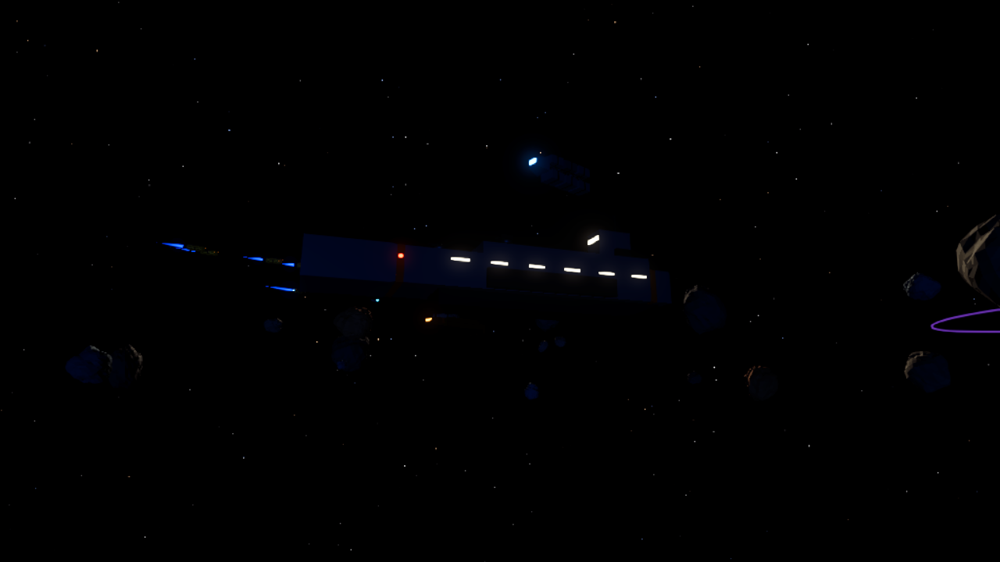
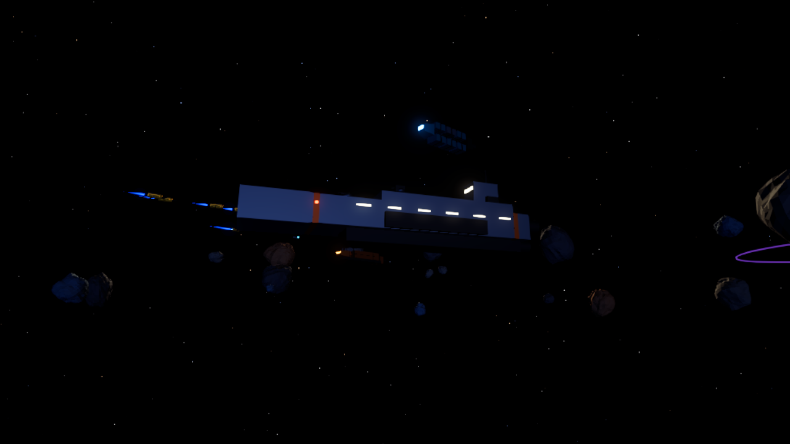
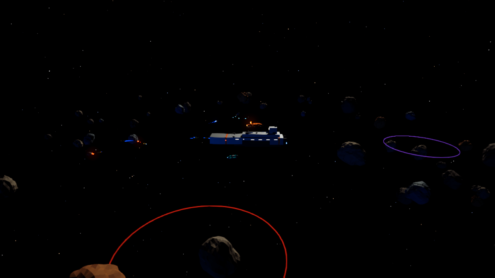
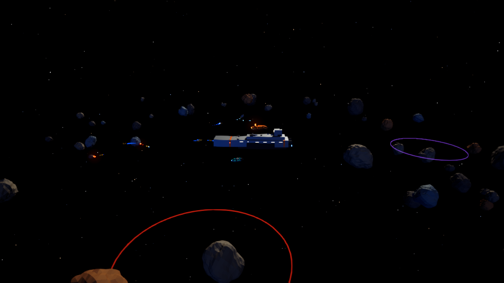

# Tactical readability and keyboard input

[Sensors and hazards #90](https://github.com/deadronos/Vibe-Space-Mining-Fleet/issues/90) · [Keyboard HUD #91](https://github.com/deadronos/Vibe-Space-Mining-Fleet/issues/91) · [Small hull and rock readability #92](https://github.com/deadronos/Vibe-Space-Mining-Fleet/issues/92)

Unity changes were checked in as `cs:83` on `/main/feature-90-92-tactical-readability` (not yet merged to `/main`). Save format unchanged.

## #90 Sensors button, hazards, compact HUD

- **Gear button clearance.** The page measures the game-menu button with `getBoundingClientRect` and sends a new `pageInsets {right, bottom}` bridge command on start, `resize` and `visualViewport` resize. The rect already includes `env(safe-area-inset-*)`. `HudController.ApplyPageReserve` converts CSS px to panel units at the current scale and moves the rail (Build … Sensors) left of the button when the button reaches down to the rail. It also widens the strip's right padding. Without a report (the Editor), the USS defaults still apply.
- **Hazards.** The sensors legend now has a line for each hazard: its ring pattern, name, charted or uncharted status, and current damage rate. Debris shows 3 hull/s, or 6 hull/s with **STORM** during a storm. Radiation shows 2 hull/s. The rates come from new public `FleetSim.DebrisDamagePerSecond`, `RadiationDamagePerSecond` and `DebrisDamageRate`, which the sim itself uses, so the legend can't drift. The storm test checks `DebrisDamageRate` against the damage applied. On the plot, debris is a **dashed** ring (heavier in a storm) and radiation is a **solid ring with 12 inward ticks**, so they differ by pattern as well as hue. Each ring has a name tag (`DEBRIS`, `RADIATION`, with `?` while uncharted and `STORM` during a storm).
- **Compact group bar.** At compact sizes only assigned groups plus the first free slot (`+ n`) show. Every slot has a tooltip that says how to assign it (Shift+click / Shift+digit, or a long press on touch).
- In compact, the legend moved below the rail (`top: 122px`), because the extra lines ran under the rail.

## #91 Keyboard access

HUD buttons stay unfocusable for UI Toolkit (so a focused button can never also take Space). The HUD has its own keyboard cursor (`HudController.Keyboard.cs`):

- **Enter** shows it, on the control it was last on, or on Build first. **Tab**, **Shift+Tab** and the arrow keys move it. **Enter** or **Space** presses the control once. **Esc**, any mouse button or a touch hides it.
- Stops, in order: rail (Build, Research, Modules, Fleet, Sensors, plus a keyboard-only **Game menu** stop), Build tab buttons when open, every visible command bar button, the group slots (Shift+Enter assigns), the Events toggle.
- **Ownership:** `HudController.KeyboardOwnsNavigation` is true while the cursor shows, and while the page's menu has the keyboard. `FleetCamera` (Space sensors, Tab follow), `FleetCommander` (Shift+Space) and `SelectionController` (Esc) skip those keys meanwhile. Other hotkeys (B, T, G, Y, L, R, M, S, H, A, V, F, digits) keep working.
- **Game menu:** the stop emits a new `menu` event, and the page opens its dialog. The page now sends `menuOpen {value}` when the dialog opens or closes. Unity then sets `WebGLInput.captureAllKeyboardInput` off while the dialog is open. Before this change, Unity captured Tab in the dialog, so focus couldn't move between its buttons, and the Esc that closed the dialog also reached the game. When the dialog closes, the page refocuses the canvas, and the cursor is still on the stop it was on.
- The idle command hint now ends with "Enter moves through the HUD by keyboard". A keyboard hint shows above the group bar while the cursor is active.

## #92 Camera fill light

`CameraFill` (Scripts/Views) drives a shadowless directional light from just above and beside the camera, in a cool white (0.72, 0.8, 1). Its intensity is 0.18 close in, rising to 0.42 at 160 units and beyond. The sun is 1.8. The scene builder creates it under `CameraFill` on the main camera.

`ReadabilityShots.Capture()` (Editor) renders matched fill-off and fill-on shots at the opening angle, from the carrier's dark side, and zoomed out. Run it in play mode through `script eval`. Mean luma at the home system, sim time 31 s:

| Pose | Fill off | Fill on |
| --- | ---: | ---: |
| Opening | 0.008 | 0.009 |
| Dark side | 0.003 | 0.007 |
| Zoomed out | 0.005 | 0.006 |

| Dark side, off | Dark side, on |
| --- | --- |
|  |  |
| Zoomed out, off | Zoomed out, on |
|  |  |

On the dark side, drones and rocks that were black silhouettes become visible. Engines, status lights and the hazard rings look the same with the fill on.

## Verification

- Unity: compiled, EditMode 266 of 266 passed. Web: `pnpm run check` passed (lint, format, typecheck, 6 tests).
- Player size: data 3,167,178 → 3,169,605 B, wasm 7,514,231 → 7,518,010 B (+6.2 KB total). Loader and framework unchanged.
- Built-in browser, WebGPU, 1200 × 832:
  - The gear button covers x 1148–1188, y 12–52. The rail and Sensors button render fully left of it.
  - Enter showed the cursor on Build. Five single Tabs reached Game menu without cycling the camera target.
  - Space on Fleet opened the Fleet tab once, with no sensors toggle. Space on Sensors opened the sensors view once.
  - Esc hid the cursor, and Enter restored it on the same stop.
  - Game menu opened the dialog with focus on Save now; Tab moved focus to Export save. Esc closed the dialog, the canvas got focus back, and the cursor still showed on Game menu.
  - With the cursor hidden, Space toggled sensors again.
- 844 × 390 with synthetic touch: the group bar showed group 1 and `+ 2` only. A tap on the right edge of Sensors, next to the gear, opened the sensors view. The legend sits below the rail.
- `?renderer=webgl2` loaded as WebGL 2 with no console errors.

## Open points

- **Frame time** with and without the fill light was not measured. The built-in pane's timings aren't reliable. One extra shadowless directional light per pixel should be cheap, but measure it with `?bench=500` on both renderers (as in #30) before a release.
- **Safe-area insets** were not tested on a notched device. The reserve uses the button's measured rect, which already includes the insets.
- The compact strip still wraps its stats onto two lines at 844 px, as before this change.
- The keyboard cursor does not reach Research, Modules or Fleet tab contents (rows inside scroll views), nor selection list rows. Their tabs can still be opened by keyboard (T, G, Y or the rail).
- Fast key repeats inside one frame count once (`wasPressedThisFrame`). The tool's `repeat` sent four Tabs within a single frame, and the cursor moved three stops.
