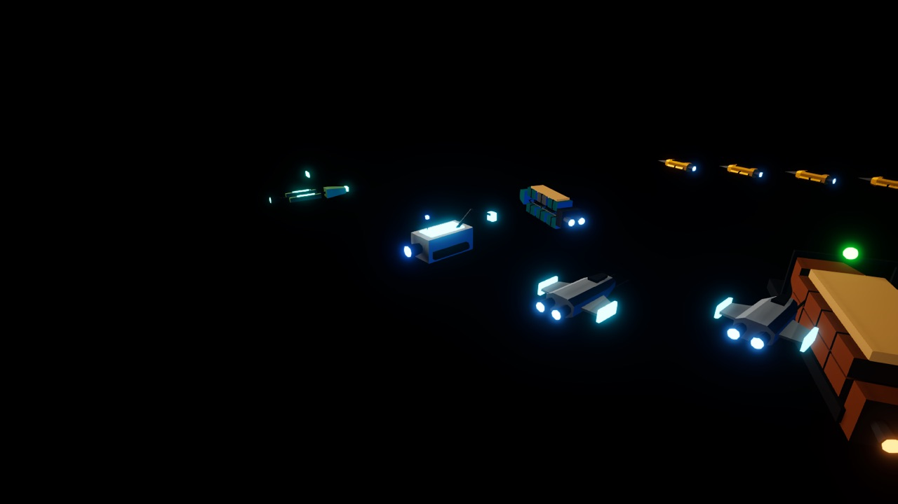
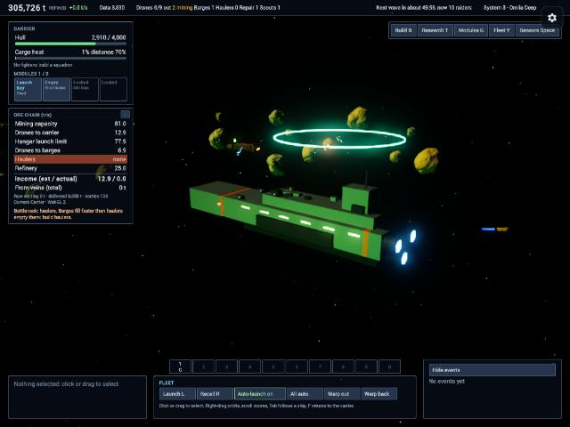

# Repair and scout ships

GitHub issue: none yet (to be opened with the PR). Design: [design.md](design.md). Plan: [plan.md](plan.md). Decision: [ADR 0018](../../agents/decisions/0018-repair-and-scout-ships.md). Builds on #14 (PR #81, ADR 0017).

## Where the code lives

| | |
| --- | --- |
| UVCS branch | `/main/feature-repair-scout`, branched from cs:71 (`/main/feature-14-foundry-models`, not merged yet) |
| Changeset | `cs:72` |
| Repository | `Vibe-Space-Mining-Fleet/Vibe-Space-Mining-Fleet@iridanblub@unity` |

## What changed in the Unity project

**Sim (`SpaceMining.Sim`)**

- `SimSupport` (one unit type with a `Role` of `UnitKind.Repair` or `UnitKind.Scout`), `SupportState`, `SupportSettings` (all numbers), `FleetSim.Support.cs` (automation, orders, repair, scouting). Enums appended: `UnitKind.Repair/Scout`, `OrderKind.Repair`, `TargetKind.Support`, `SimEventKind.VeinStrike`.
- Building, counts, caps (4 repair, 3 scouts), class fire stances (Repair Stand, Scout Flee), unit stances and groups, damage and fleeing, pirate targeting, recall, warp and carrier loss all include support ships.
- Repair: the most damaged friendly ship within 150 (unclaimed first, never itself), 15 hull/s from 20 units, 2.5 refined ore per hull point; stops at full, dead, docked or out of range. Repair orders target one unit at any range.
- Scouts: the nearest rock not surveyed since it spawned, a 2 s scan, then the existing `Survey()`. `SimAsteroid.Surveyed` is set by any survey and cleared on respawn. Scouts take Survey orders.
- Vein strike: a full load on a vein rock adds 50% of drone capacity on top, not taken from the rock; `SimDrone.VeinBonus` until unloaded; `FleetSim.VeinOre` totals it; `VeinStrike` event (no notice).
- Save version 10 (`supports`, `veinOre`, drone `veinBonus`, rock `surveyed`); versions 2–9 still load. The validator now accepts queued repair and scout builds.

**Views, input and HUD**

- `Repair.prefab` and `Scout.prefab` from the Foundry models (`FoundryHulls`), `SupportView` (scan ring), `FleetSimRunner` role-aware view matching.
- `CombatFx`: pulsing blue repair beam; gold spark burst on a vein strike. Drones carrying a strike's bonus get gold trails (batched and unbatched). Vein rocks are tinted gold.
- Selection, picking, groups (`R`, `Sc` in the group bar), context orders (repair ships only: right-click a friendly ship or the carrier to repair it; V survey mode with scouts), order paths, selection rows, rings, hull bars, sensors icons, stance scopes ("Repair ships", "Scouts"), Build menu buttons, "Still out" list, and an ore chain row "From veins (total)".

**Web shell:** `protocol.ts` `UnitKind` gains `'repair' | 'scout'`.

## Verification

- `scripts/unity-check.sh`: compiled, EditMode **252 of 252** (211 before; 41 new in `SupportTests` and `FoundryModelTests`), covering building and caps, stances, damage, recall and warp, repair targeting, claiming, cost, running out of ore, dead targets, repair orders, Stand vs Flee, scouting, scan time, whole-field coverage, respawned rocks, survey orders, the vein strike and its edge cases, save round trip through JSON, loading a version 9 save mid-warp, and queued builds in a save.
- `pnpm run check` passes.
- Web build in the browser (port 5199), WebGPU and `?renderer=webgl2`: an old version 9 save loaded; the repair ship repaired a barge from 150 to 500 hull, charging exactly 2.5 ore per point; the scout scanned (ring visible) and the "Survey complete" notice appeared; with veins seeded, drones struck for 90 t loads and "From veins" counted 60, then 120 t; vein rocks show gold; the Build menu lists "Repair 1,500" and "Scout 800". No console errors on either renderer.

## Build size

| Gzipped | data | wasm |
| --- | --- | --- |
| PR #81 (Foundry models) | 3,158,791 B | 7,501,570 B |
| This change | 3,165,043 B (+6.3 KB) | 7,513,911 B (+12.3 KB, new code) |

## Not checked in the browser

- Selecting support ships, their selection rows and hull bars, the right-click repair order and V survey with scouts. The sim side is covered by tests; the UI code mirrors the hauler paths.
- The gold drone trail up close (strikes were confirmed by state, not by a close-up).

## Open points

- Numbers are starting points (in `SupportSettings`): costs, caps, repair rate, scout speed, scan time, strike bonus.
- Scout survey notices stay on; filter to "found veins" only if they get noisy in play.
- The scan ring is bright and wide when the camera is close.
